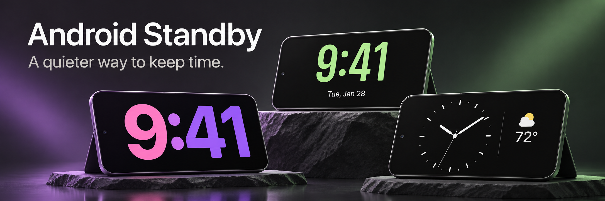
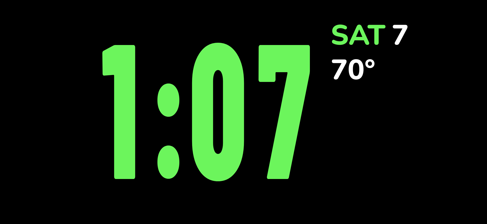
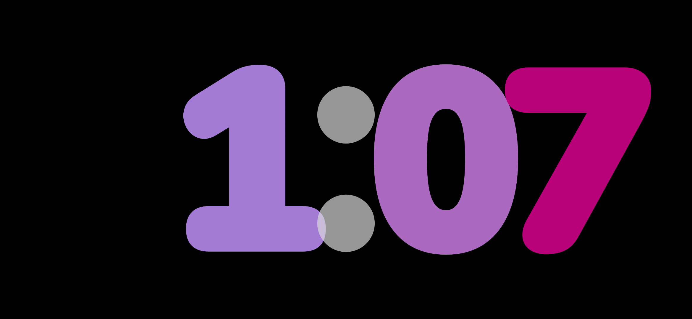
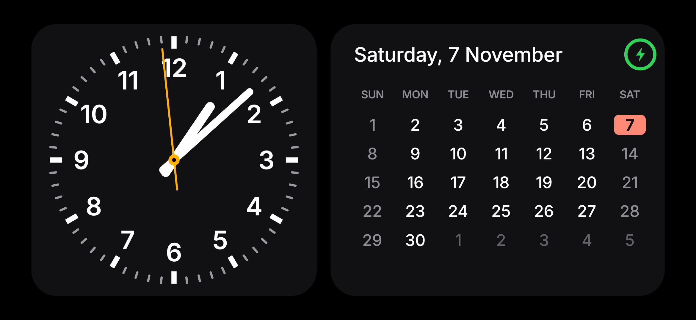

# Android Standby

**A native bedside display for Android, inspired by Apple StandBy.**

Turn a charging phone on its side into a glanceable clock, music player, photo display, or information board. Preview each frame before choosing it, build a carousel of up to three favorites, and change looks directly on the display.

Built with Java and Android Canvas, with an integrated system screensaver and an optional Instant mode. Android 9 (API 28) is the minimum supported build target; physical compatibility and background activation still depend on the device.

[Clock examples](#three-signature-clock-looks) · [Frame collection](#frame-collection) · [Setup](#get-started) · [Build](#build-from-source) · [Validation](#validation-and-current-limits)

> The banner is an AI-generated promotional illustration. The three clock examples below are actual renders from the current debug build. This project is independent of Apple and Samsung.

## Three signature clock looks

### Digital

Tall numerals with a compact date, temperature, and next-alarm area. Fixed digit cells keep the composition stable as the time changes, including the transition from a one-digit to a two-digit hour.



### Float

Oversized rounded numerals, layered color, and a quiet black background. A full-screen alternative for a display focused on time.



### Dial with calendar

A white analog dial and month view in two rounded box frames. The current date receives a clear accent, with charging status kept in the corner.



*Captured on 7 November 2026 using the app renderer in an Android API 37 emulator. Weather is sample data. These images demonstrate layout, not physical-device acceptance.*

## What it does

- **Preview before choosing.** Browse renderer-based thumbnails, inspect named looks, and apply your frame selection and order.
- **23 frame families, 44 looks.** Keep up to three frames in the active carousel, each with its own variants where available.
- **Physical posture detection.** Uses hardware motion data to recognize a sideways, inclined resting position independently of Android's rotation-lock setting. Upright portrait posture is excluded by the tilt gate.
- **Music at a glance.** Album artwork, artwork-derived glow, animated bars, title and artist, elapsed and remaining time, playback controls, and seeking when supported by the active media session. Optional automatic switching to music and return behavior.
- **Calls and alarms.** Dedicated alert compositions use available notification actions, with contact information when permitted. Controls depend on the originating app and granted permissions.
- **Personal information frames.** Local photo slideshows, world clocks, current weather, sun and moon information, date views, and timer integration.
- **Bedside controls.** Adjustable brightness, ambient-light night styles, schedules, and subtle burn-in shifting.

## Frame collection

| Family | Included frames |
| --- | --- |
| Signature clocks | Digital, Dial |
| Listening and photos | Music, Clock and Music, Photos |
| Classic and typographic | World, Flip, Word clock, Dot matrix, Nixie, Alarm LED, Railway |
| Time and astronomy | Orbit, Sun path, Moon, Time left, Big date |
| Ambient and utility | Weather, Aurora, Breathe, Terminal, Sky, Timer |

Digital includes Digital and Float. Dial includes Analog, Widgets, and Calendar. Other families provide one or two looks; 44 looks are available in total. The default carousel is Digital, Dial, and Music.

## Get started

1. Build and install the APK using the instructions below.
2. Open **Android Standby**, explore the frame gallery, choose up to three frames, and apply your selection.
3. Enable only the integrations you want, such as notification access for music or location for weather.
4. In Android **Settings → Screen saver**, choose Android Standby and use **Preview**. The settings location and charging options vary by manufacturer.
5. Place the phone sideways on an inclined stand. Configure activation and display options for your device.

### Two ways to display

| Mode | Behavior |
| --- | --- |
| System screensaver | Runs through Android's `DreamService`. Android controls when the screensaver starts, usually according to charging and screen-timeout settings. Use system Preview to inspect it. |
| Optional Instant mode | Uses a foreground service to watch charging and posture, then attempts to open the full-screen display. Overlay access, notification access, lock-screen rules, and manufacturer restrictions can affect activation. |

This is an installed Android application with a screensaver service. It does **not** replace Samsung's firmware-level, low-power Always On Display. A screen-on standby view has different power characteristics from hardware AOD.

### Controls

| Gesture | Action |
| --- | --- |
| Swipe left or right | Move between selected frames; the carousel wraps |
| Swipe up or down | Change the current frame's look |
| Tap an available non-control area | Cycle the current frame's look |
| Touch and hold | Reveal the brightness control |
| Use the music controls or timeline | Control the active media session, where supported |

### Permissions and data

| Access | Used for |
| --- | --- |
| Notification access | Discover media sessions and supported call, alarm, and timer notifications |
| Location and internet | Fetch weather from Open-Meteo using a last-known coarse location; cache conditions locally |
| Selected documents/photos | Read images explicitly chosen through Android's document picker |
| Phone and contacts permissions | Optional caller information and supported call handling |
| Overlay, notifications, and full-screen intent access | Optional Instant-mode activation, subject to OS policy |
| Foreground service and boot receiver | Keep the enabled activation service available and restore it after supported restart events |

Weather requests send coordinates to Open-Meteo. Notification and media access can expose sensitive information, so grant these only when you want the corresponding features. Lock-screen notification handling respects available public notification content. No weather API key is required.

## Build from source

### Requirements

- Android SDK with **platform 36** and compatible build tools.
- **Gradle 8.13** installed locally; a Gradle wrapper is not currently checked in.
- A compatible JDK; the recorded local build used JDK 22.
- Android 9/API 28 or newer for installation.

The project uses Android Gradle Plugin **8.13.2**, `compileSdk 36`, and `targetSdk 35`.

```bash
git clone https://github.com/InsaneCoder789/Android-Standby.git
cd Android-Standby

# macOS example; use your SDK path on other systems.
export ANDROID_HOME="$HOME/Library/Android/sdk"
gradle testDebugUnitTest assembleDebug lintDebug
```

Debug APK:

```text
app/build/outputs/apk/debug/app-debug.apk
```

Install on an authorized device or emulator:

```bash
adb install -r app/build/outputs/apk/debug/app-debug.apk
```

The application ID is `com.rohan.standby`. Release builds enable code and resource shrinking. Configure an untracked `keystore.properties` for your own release signing; without it, the current configuration uses the debug key for testing. Keep signing keys and passwords out of Git.

## Implementation guide

| Area | Main source files |
| --- | --- |
| Frame catalog and preferences | `Frames.java`, `Prefs.java` |
| Rendering, transitions, and gestures | `StandbyView.java`, `ClockFrames.java`, `NewFrames.java`, `TimeCells.java` |
| Preview gallery and configuration | `SettingsActivity.java` |
| Screensaver and full-screen hosts | `StandbyDream.java`, `StandbyActivity.java`, `StandbyController.java` |
| Charging and posture activation | `InstantService.java`, `TiltGate.java`, `InstantTrigger.java` |
| Media and alert surfaces | `MediaListener.java`, `MusicFrame.java`, `NowBar.java`, `CallFrame.java` |
| Weather, astronomy, and timers | `Weather.java`, `Astro.java`, `Timers.java` |

Sources live in [`app/src/main/java/com/rohan/standby`](app/src/main/java/com/rohan/standby). Pure logic tests live in [`app/src/test`](app/src/test). The UI uses native views and Canvas rendering with bundled fonts.

## Validation and current limits

The latest recorded full verification passed **146 JVM tests**, assembled the debug APK, and completed debug lint with **44 warnings**. Following the thumbnail-clipping repair, the APK was rebuilt and the app interface and all 44 looks were captured on an API 37 emulator without an observed fatal exception during capture.

- Emulator screenshots cover rendered layouts. Music, weather, call, and alarm examples use fixtures or synthetic sessions/notifications.
- Physical Samsung validation of this latest iteration, real incoming calls, vendor music behavior, and background activation remain pending.
- Android 9 is the minimum SDK, but end-to-end physical validation on Android 9 has not been completed.
- Media seeking and alert actions depend on what the originating app exposes. Missing access or unavailable data can produce an empty state.
- Debug capture utilities can clear preferences and seed test data. Run them only on disposable test installs.

For problems, include the frame/look, device model, Android version, activation mode, permissions, and a screenshot or reproducible steps. Keep private notifications and caller details out of shared reports.

## Repository notes

The repository was initialized from an existing uncommitted workspace on 7 November 2026. Initial import commits have explicitly reconstructed dates spanning 5–7 November 2026 at the owner's request; those dates do not establish implementation or test dates. Later iteration commits record subsequent changes.

The banner and selected screenshots are tracked in [`docs/assets`](docs/assets). Other local capture sets, generated design explorations, SDK configuration, credentials, and signing keys are excluded from Git. Banner provenance and its generation prompt are recorded in [`docs/assets/README.md`](docs/assets/README.md).
